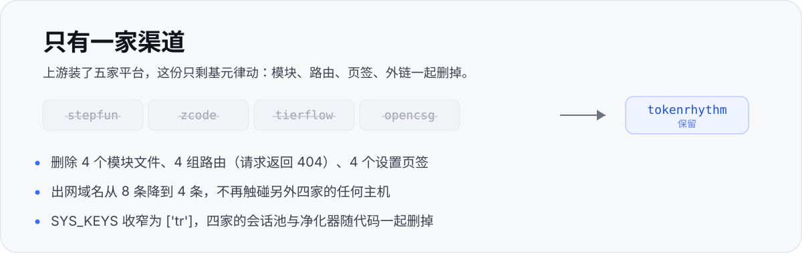

<p align="center">
  
</p>

基元律动（tokenrhythm.studio）费用中心的 DSH 插件，**单渠道版**。上游那份装了五家平台；这里把另外四家的代码删掉，只留基元律动一家。

## 一眼看完


账户余额与限时额度（到期失效），今日的调用 / 输入 / 输出 / 缓存命中 / 花费，近 7 天花费柱状与最近调用明细，每 60 秒自己刷新。


22 个模型的上下文、输入、输出、缓存、最大输出五项价格；折扣和峰谷分时直接标在卡上，顶部可按文本 / 图像 / 视频筛选。


账号管理在同一个面板里：加账号、看当前会话登录状态、备用时手动粘贴凭证。

## 装上

```sh
dsh plugin --profile desktop remove dsh-tokenrhythm-bill
dsh plugin --profile desktop add github:DongHua3/dsh-tokenrhythm
```

装完**必须重启 DSH**。装在本地目录时，把 `github:...` 换成目录路径即可。

## 为什么是「单渠道」

<p align="center">
  
</p>

删除不是藏起来，是**物理删除**——模块、路由、页签、外链按钮全部不见：

<details>
<summary>删掉的具体范围</summary>

- `lib/step.js`、`lib/tierflow.js`、`lib/opencsg.js`、`lib/zcode.js` —— 文件已删
- `/dsh-tokenrhythm-bill/stepfun/*`、`/tierflow/*`、`/opencsg/*`、`/zcode/*` —— 全部路由（请求返回 404）
- `index.js` 里四家的实现、净化器、会话池、持久化分支
- `client.js` 里四家的页签 UI 与三个外链按钮（`opencsg.com` / `tierflow.cn` / `platform.stepfun.com`）
- `SYS_KEYS` 由 `['tr','step','zcode','tf','oc']` 收窄为 `['tr']`
- 输入行的「计划模式 / 压缩上下文」两个快捷按钮，与设置里的「系统管理」分组

</details>

## 功能一览

| 功能 | 说明 |
| --- | --- |
| 密钥管理 | 列表掩码、复制完整值、新建 / 删除 |
| 账号管理 | 多账号、密码登录、Cookie 粘贴、自动续期 |
| 连通检测 | 真实 1-token 探测，**默认关闭**，手动开启才会计费 |
| 余额角标 | 侧栏入口右侧直接显示在用密钥的账户余额 |

<p align="center">
  
</p>

## 更新

「检查更新」的版本源就是**本仓库 `main` 分支的 `package.json`**：push 一个更高的 `version` 即生效，不用发 release。检查结果本地缓存 24 小时，拉取失败时降级显示上次结果。

```sh
dsh plugin --profile desktop add github:DongHua3/dsh-tokenrhythm
```

## 凭据与出网

凭据只落在 host 进程：`~/.dsh/tokenrhythm-bill-state.json`，首次写入即 `mode 0o600`。Cookie / 密码 / 密钥不经浏览器，也不上传任何第三方。

出网域名只有四条：

```text
https://tokenrhythm.studio                    # 基元平台 API
https://raw.githubusercontent.com             # 版本检查（读本仓库 main 的 package.json）
https://cdn.jsdelivr.net/gh                   # 同上，raw 连不上时兜底
https://api.github.com                        # 同上，最后兜底（tags 列表）
```

`platform.stepfun.com` / `account.stepfun.com` / `api.stepfun.com` / `tierflow.cn` / `opencsg.com` / `zcode.z.ai` / `open.bigmodel.cn` / `~/.zcode/v2` 都不再触碰。

## 自检

```sh
node scripts/smoke.mjs
```

语法 / 加载 / 路由注册 / 跨站拦截四项，CI 在每次 push 时跑同一支脚本。

## 已知缺陷

ESLint `no-undef` 报 3 处：`client.js` 的 `cur`、`setTfPlansScope`、`setStepKeyCreated`。三者都有定义，属于作用域分析误报；后两者所在分支已被 `SYS_KEYS=['tr']` 判死，不会执行。这是上游 0.7.5 原样带过来的，不是本项目引入。

## 与上游的关系

fork 自 [162568316/dsh-tokenrhythm-bill](https://github.com/162568316/dsh-tokenrhythm-bill) v0.7.5（MIT），版本号从 `0.1.x` 起与上游脱钩。包名仍为 `dsh-tokenrhythm-bill`——它必须和 `cordis.patch.yml` 里的 `name` 一致；仓库名才是本项目自己的。

## 许可

沿用上游 MIT。原始版权归 162568316 与贡献者所有。
