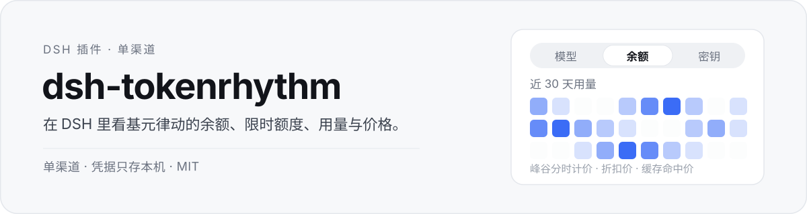
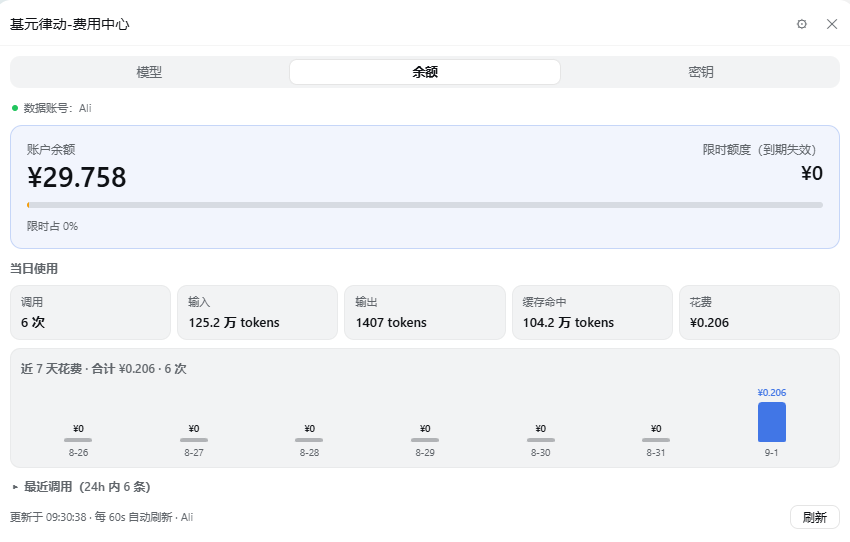
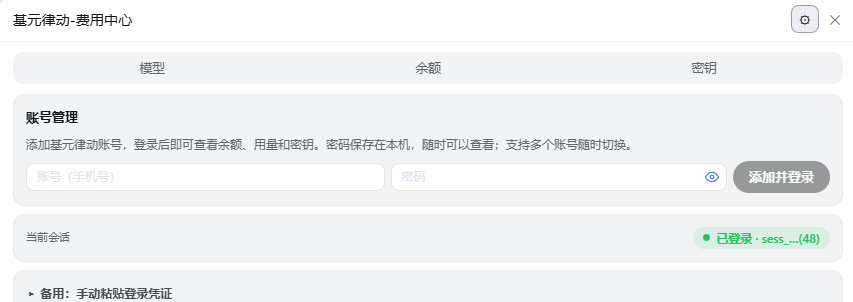

<p align="center">
  
</p>

基元律动（tokenrhythm.studio）费用中心的 DSH 插件，**单渠道版**。上游那份装了五家平台；这里把另外四家的代码删掉，只留基元律动一家。

## 一眼看完



账户余额与限时额度（到期失效），今日的调用 / 输入 / 输出 / 缓存命中 / 花费，近 7 天花费柱状与最近调用明细，每 60 秒自己刷新。


22 个模型的上下文、输入、输出、缓存、最大输出五项价格；折扣和峰谷分时直接标在卡上，顶部可按文本 / 图像 / 视频筛选。



账号管理在同一个面板里：加账号、看当前会话登录状态、备用时手动粘贴凭证。

## 装上

**桌面版**：在 App 的插件管理器里「添加插件」，粘贴

```
github:DongHua3/dsh-tokenrhythm
```

**命令行**：只对 `web` 这类 profile 有效。桌面版的 `desktop` profile 由 App 独占，CLI 会以 `profile "desktop" is managed exclusively by the Electron application` 拒绝写入——

```sh
dsh plugin --profile web add github:DongHua3/dsh-tokenrhythm
```

装完**必须重启 DSH**。装本地目录时把 `github:...` 换成目录路径。

从 0.1.x 升上来的，先在插件管理器里移除旧插件 `dsh-tokenrhythm-bill` 再装。0.2.0 换了包名与 cordis id，新包不会顶替旧行——不移除的话侧栏会出现两条入口。

## 兼容性

| 项 | 要求 |
| --- | --- |
| DSH | 宿主需同时提供 `webServer` 与 web GUI；在桌面版 0.2.1-rc.3 上实测 |
| Node | ≥ 20（`package.json` 的 `engines`） |
| 系统 | 代码里没有平台专属调用，目前只在 Windows 上验证过 |

## 功能一览

| 功能 | 说明 |
| --- | --- |
| 密钥管理 | 列表掩码、复制完整值、新建 / 删除 |
| 账号管理 | 多账号、密码登录、Cookie 粘贴、自动续期 |
| 连通检测 | 真实 1-token 探测，**默认关闭**，手动开启才会计费 |
| 余额角标 | 侧栏入口右侧直接显示在用密钥的账户余额 |
| 快捷键 | `Ctrl/Cmd + J` 开合面板（网页版 `Ctrl/Cmd + Alt + J`，网页版 Linux 默认不绑），可在 DSH 快捷键设置里改 |

<p align="center">
  
</p>

## 更新

「检查更新」的版本源就是**本仓库 `main` 分支的 `package.json`**：push 一个更高的 `version` 即生效，不用发 release。检查结果本地缓存 24 小时，拉取失败时降级显示上次结果。

更新就是再装一次：插件管理器里把 `github:DongHua3/dsh-tokenrhythm` 重新添加，或走上面的命令行（`web` profile）。

## 凭据与出网

凭据只落在 host 进程：`~/.dsh/tokenrhythm-bill-state.json`（文件名沿用改名前的，升级不丢登录），首次写入即 `mode 0o600`。Cookie / 密码 / 密钥不经浏览器，也不上传任何第三方。

出网域名只有四条：

```text
https://tokenrhythm.studio                    # 基元平台 API
https://raw.githubusercontent.com             # 版本检查（读本仓库 main 的 package.json）
https://cdn.jsdelivr.net/gh                   # 同上，raw 连不上时兜底
https://api.github.com                        # 同上，最后兜底（tags 列表）
```

`platform.stepfun.com` / `account.stepfun.com` / `api.stepfun.com` / `tierflow.cn` / `opencsg.com` / `zcode.z.ai` / `open.bigmodel.cn` / `~/.zcode/v2` 都不再触碰。

## 自检

```sh
node scripts/smoke.mjs
```

语法 / 加载 / 路由注册 / 跨站拦截四项，CI 在每次 push 时跑同一支脚本。

## 已知问题

`npm run lint` 当前是 **0 error / 96 warning**，没有一条 `no-undef`。96 条全是 `no-unused-vars`，集中在 `lib/client.js`：`tf*`、`step*`、`oc*`、`zc*` 这些是删掉四家渠道后没跟着扫掉的孤儿函数与 hook，剩下来不影响运行，只是死代码。

CI 用的是 `--quiet`，只报 error，所以这些警告不会让流水线变红——也正因为这样，删完之后没人再数一遍。

## 与上游的关系

fork 自 [162568316/dsh-tokenrhythm-bill](https://github.com/162568316/dsh-tokenrhythm-bill) v0.7.5（MIT），版本号从 `0.1.x` 起与上游脱钩。

0.2.0 起三个身份都和上游分开了，所以两份能装在一起：

| | 本项目 | 上游 |
| --- | --- | --- |
| 包名 | `dsh-tokenrhythm` | `dsh-tokenrhythm-bill` |
| cordis id | `donghua-tokenrhythm` | `tokenrhythm-bill` |
| HTTP 路由前缀 | `/dsh-tokenrhythm/*` | `/dsh-tokenrhythm-bill/*` |

## 许可

沿用上游 MIT。原始版权归 162568316 与贡献者所有。
